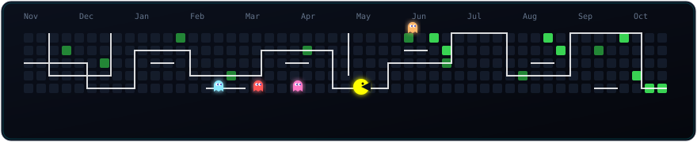

<!-- ══════════════════════════════════════════════════════
     CYBER 3D HEADER BANNER (Self-Contained Local SVG)
══════════════════════════════════════════════════════ -->

<!-- ══════════════════════════════════════════════════════
     LIVE TELEMETRY BADGES
══════════════════════════════════════════════════════ -->

  &nbsp;&nbsp;
  &nbsp;&nbsp;
  &nbsp;&nbsp;
  

<!-- ══════════════════════════════════════════════════════
     HOLOGRAPHIC SCANNING AVATAR & NEOFETCH TERMINAL
══════════════════════════════════════════════════════ -->

<!-- ══════════════════════════════════════════════════════
     FEATURED ENGINEERING PROJECTS (2x2 Bento Grid)
══════════════════════════════════════════════════════ -->
<h2 align="center">⚡ Featured Engineering Systems</h2>

 

| System | Technology Stack | Architecture & Breakthroughs | Repository |
|:---|:---|:---|:---:|
| 🤟 **SignGesture AI** | `Python` `OpenCV` `MediaPipe` `Scikit-Learn` | Two-way ASL bridge with **99.73% ML accuracy**, 21-landmark vector analysis & offline TTS | [**Inspect Code →**](https://github.com/Souvik444411/SIGN-LANGUAGE-DEC) |
| 🔐 **Decentralized KYC** | `Solidity` `Ethereum` `Web3.js` | Zero-trust on-chain identity protocol eliminating single-point vulnerabilities | [**Inspect Code →**](https://github.com/Souvik444411/Decentralized-KYC-blockchain) |
| ⚡ **GFG 160-Day DSA** | `C++` `Graph Theory` `DP` `Trees` | 160-day intensive algorithmic sprint solving complex dynamic programming & data structures | [**Inspect Code →**](https://github.com/Souvik444411/GFC-160-Dayschallenge) |
| 🛒 **E-Commerce Web Suite** | `JavaScript` `HTML5` `CSS3` | Modern storefront engine with dynamic shopping cart, real-time filtering & checkout UX | [**Inspect Code →**](https://github.com/Souvik444411/Amazon_frontend_code) |
| 🪙 **NFT Manager** | `Clarity` `Stacks Blockchain` | Smart contract architecture for minting and governing non-fungible assets on Bitcoin L2 | [**Inspect Code →**](https://github.com/Souvik444411/NFT_Collection_Manager_Final) |

 

<!-- ══════════════════════════════════════════════════════
     CORE SKILLS & LIVE BENCHMARKS
══════════════════════════════════════════════════════ -->
<h2 align="center">📊 Core Capabilities & Live Benchmarks</h2>

<!-- ══════════════════════════════════════════════════════
     3D CELESTIAL TECH UNIVERSE
══════════════════════════════════════════════════════ -->
<h2 align="center">🪐 3D Celestial Tech Universe</h2>

<!-- ══════════════════════════════════════════════════════
     CONTRIBUTION STREAK & ARCADE ACTIVITY
══════════════════════════════════════════════════════ -->
<h2 align="center">📈 Contribution Activity & Streak</h2>

  

<!-- ══════════════════════════════════════════════════════
     CONNECT & NETWORK BUTTONS
══════════════════════════════════════════════════════ -->
<h2 align="center">🌐 Connect & Network</h2>

  &nbsp;&nbsp;
  &nbsp;&nbsp;
  &nbsp;&nbsp;
  

 

<!-- ══════════════════════════════════════════════════════
     CYBER WAVE FOOTER
══════════════════════════════════════════════════════ -->

 

  <code>// SOUVIK CHOWDHURY · SYSTEM STATUS: OPERATIONAL · JAIPUR, INDIA · 2024</code>

