<!-- ==================== HEADER BANNER ==================== -->

  

<!-- ==================== DUAL CARDS: PROFILE HUD & TERMINAL ==================== -->
<table border="0" cellpadding="0" cellspacing="0" width="100%">
  <tr valign="top">
    <td width="44%" align="center">
      
    </td>
    <td width="56%" align="center">
      
       
      
    </td>
  </tr>
</table>

 

<!-- ==================== SECTION: ABOUT ME ==================== -->

<h3><code>// ABOUT_ME</code></h3>

  <b>I'm Souvik Chowdhury — B.Tech CSE (AIML) student at UEM Jaipur &amp; Full-Stack AI Engineer.</b> 
  I engineer real-time assistive systems, deep learning computer vision pipelines, Web3 smart contracts, and high-performance software. 
  <i>This GitHub profile is my digital workspace &amp; neural laboratory — experiment, innovate, ship.</i>

  
  
  
  

 

<!-- ==================== SECTION: FEATURED PROJECTS ==================== -->

<h3><code>// FEATURED_PROJECTS</code></h3>

  

<!-- Detailed Project Showcase Table -->
<table width="100%">
  <thead>
    <tr>
      <th align="left">🚀 Project</th>
      <th align="left">🧠 Core Tech</th>
      <th align="left">⚡ Highlights</th>
      <th align="center">🔗 Repository</th>
    </tr>
  </thead>
  <tbody>
    <tr>
      <td><b>🤟 SignGesture AI</b></td>
      <td><code>Python</code> <code>MediaPipe</code> <code>OpenCV</code> <code>Scikit-learn</code></td>
      <td>Two-way real-time assistive communication bridging deaf &amp; hearing users with <b>99.73% ML accuracy</b>, 21-landmark 3D skeleton tracking &amp; offline TTS.</td>
      <td align="center"><a href="https://github.com/Souvik444411/SIGN-LANGUAGE-DEC"><b>View Code ↗</b></a></td>
    </tr>
    <tr>
      <td><b>🔐 Decentralized KYC</b></td>
      <td><code>Solidity</code> <code>Ethereum</code> <code>Web3.js</code> <code>Truffle</code></td>
      <td>Tamper-proof identity verification eliminating centralized customer data vulnerabilities through immutable smart contracts.</td>
      <td align="center"><a href="https://github.com/Souvik444411/Decentralized-KYC-blockchain"><b>View Code ↗</b></a></td>
    </tr>
    <tr>
      <td><b>⚡ Algorithmic Mastery</b></td>
      <td><code>C++</code> <code>Data Structures</code> <code>Graph Theory</code></td>
      <td>Comprehensive solution repository conquering 160 days of rigorous algorithmic challenges, dynamic programming, and optimization.</td>
      <td align="center"><a href="https://github.com/Souvik444411/GFC-160-Dayschallenge"><b>View Code ↗</b></a></td>
    </tr>
    <tr>
      <td><b>🛒 Modern E-Commerce UI</b></td>
      <td><code>JavaScript</code> <code>HTML5</code> <code>CSS3</code> <code>Responsive</code></td>
      <td>High-fidelity e-commerce client architecture with responsive design, dynamic cart orchestration, and fluid micro-animations.</td>
      <td align="center"><a href="https://github.com/Souvik444411/Amazon_frontend_code"><b>View Code ↗</b></a></td>
    </tr>
  </tbody>
</table>

 

<!-- ==================== SECTION: 3D TECH UNIVERSE ==================== -->

<h3><code>// 3D_TECH_UNIVERSE</code></h3>

  

<!-- ==================== SECTION: SKILLS MATRIX & ECOSYSTEM ==================== -->

<h3><code>// SKILLS_MATRIX &amp; TOOLKIT</code></h3>

<table width="100%">
  <tr>
    <td width="25%"><b>💻 Core Languages</b></td>
    <td>
      
      
      
      
      
      
      
    </td>
  </tr>
  <tr>
    <td><b>🧠 AI &amp; Computer Vision</b></td>
    <td>
      
      
      
      
      
      
    </td>
  </tr>
  <tr>
    <td><b>🌐 Full-Stack &amp; Web</b></td>
    <td>
      
      
      
      
      
    </td>
  </tr>
  <tr>
    <td><b>🗄️ Databases &amp; Cloud</b></td>
    <td>
      
      
      
      
    </td>
  </tr>
  <tr>
    <td><b>🛠️ Tools &amp; Workflow</b></td>
    <td>
      
      
      
      
      
    </td>
  </tr>
</table>

 

<!-- ==================== SECTION: GITHUB METRICS ==================== -->

<h3><code>// GITHUB_TELEMETRY</code></h3>

  
  &nbsp;
  

  

 

<!-- ==================== SECTION: CONTRIBUTION EXPEDITION ==================== -->

<h3><code>// CONTRIBUTION_EXPEDITION</code></h3>

  

<!-- ==================== SECTION: CONNECT ==================== -->

<h3><code>// CONNECT</code></h3>

  
  &nbsp;
  
  &nbsp;
  
  &nbsp;
  

 

<!-- ==================== FOOTER WAVE ==================== -->

