<div align="center">

<!-- ══════════════════════════════════════════════════════
     HEADER: Dynamic Wave Banner
══════════════════════════════════════════════════════ -->


<!-- ══════════════════════════════════════════════════════
     TYPING SVG: Animated Role & Focus Ticker
══════════════════════════════════════════════════════ -->
<a href="https://github.com/Souvik444411">
  
</a>

<br/><br/>

<!-- ══════════════════════════════════════════════════════
     METRIC BADGES
══════════════════════════════════════════════════════ -->
[](https://github.com/Souvik444411)&nbsp;
[](https://github.com/Souvik444411?tab=followers)&nbsp;
[](https://github.com/Souvik444411?tab=repositories)&nbsp;
[](https://github.com/Souvik444411/SIGN-LANGUAGE-DEC)

<br/><br/>

<!-- ══════════════════════════════════════════════════════
     HERO BANNER: Interactive Workspace & Identity SVG
══════════════════════════════════════════════════════ -->


</div>

<br/>

<!-- ══════════════════════════════════════════════════════
     SECTION: ABOUT ME / SYSTEM INTEL
══════════════════════════════════════════════════════ -->
<table width="100%" border="0" cellpadding="0" cellspacing="0">
<tr valign="top">
<td width="60%">

### `> who_am_i.py`

```python
class SouvikChowdhury:
    education    = "B.Tech in CSE (AIML) @ UEM Jaipur"
    location     = "Jaipur, Rajasthan, India 🇮🇳"
    focus_areas  = [
        "Computer Vision & Pattern Recognition",
        "Deep Learning & Real-Time Detection",
        "Web3 & Decentralized Architecture",
        "High-Performance Algorithms (C++)"
    ]
    flagship_ops = "SignGesture AI — 99.73% ASL translation"
    motto        = "Turning raw sensor data into actionable intelligence."
```

</td>
<td width="4%"></td>
<td width="36%">

### `> quick_info()`

| Key | Status |
|:---|:---|
| 🎓 **Degree** | B.Tech CSE (AIML) |
| 📍 **Base** | Jaipur, India |
| 🤖 **Specialization** | Computer Vision & ML |
| ⚡ **DSA Sprint** | 160 Days Completed |
| 💼 **Status** | Open to Opportunities |
| 📬 **Inquiries** | [LinkedIn](https://www.linkedin.com/in/souvik-chowdhury-2b0372322) |

</td>
</tr>
</table>

<br/>

<!-- ══════════════════════════════════════════════════════
     SECTION: FEATURED PROJECTS
══════════════════════════════════════════════════════ -->
<div align="center">

## 🛠️ Featured Engineering Projects



<br/>

| Project | Tech Stack | Architecture & Highlights | Repository |
|:---|:---|:---|:---:|
| 🤟 **SignGesture AI** | `Python` `OpenCV` `MediaPipe` `Scikit-Learn` | Two-way ASL translation bridge achieving **99.73% ML accuracy** with 21-landmark tracking and offline TTS | [**Inspect Code →**](https://github.com/Souvik444411/SIGN-LANGUAGE-DEC) |
| 🔐 **Decentralized KYC** | `Solidity` `Ethereum` `Web3.js` | Zero-trust identity validation on-chain eliminating single-point vulnerabilities | [**Inspect Code →**](https://github.com/Souvik444411/Decentralized-KYC-blockchain) |
| ⚡ **GFG 160-Day DSA** | `C++` `STL` `Data Structures` | 160-day intensive mastery across Graph Theory, Dynamic Programming, and Trees | [**Inspect Code →**](https://github.com/Souvik444411/GFC-160-Dayschallenge) |
| 🛒 **E-Commerce Web Suite** | `JavaScript` `HTML5` `CSS3` | High-fidelity e-commerce storefront with dynamic cart, catalog filtering & responsive layout | [**Inspect Code →**](https://github.com/Souvik444411/Amazon_frontend_code) |
| 🪙 **NFT Collection Manager** | `Clarity` `Stacks Blockchain` | Smart contract infrastructure for minting and governing non-fungible assets | [**Inspect Code →**](https://github.com/Souvik444411/NFT_Collection_Manager_Final) |

</div>

<br/>

<!-- ══════════════════════════════════════════════════════
     SECTION: SKILLS & BENCHMARKS
══════════════════════════════════════════════════════ -->
<div align="center">

## 📊 Technical Capabilities & Benchmarks



</div>

<br/>

<!-- ══════════════════════════════════════════════════════
     SECTION: TECH STACK MATRIX
══════════════════════════════════════════════════════ -->
<div align="center">

### ⚙️ Technologies & Development Arsenal

<p>
  <b>Languages &amp; Contracts</b><br/>
  
</p>

<p>
  <b>AI, Vision &amp; Web Frameworks</b><br/>
  
</p>

<p>
  <b>Data, DevOps &amp; Engineering Tools</b><br/>
  
</p>

</div>

<br/>

<!-- ══════════════════════════════════════════════════════
     SECTION: GITHUB METRICS & STREAK
══════════════════════════════════════════════════════ -->
<div align="center">

## 📈 Contribution Activity & Consistency

<table border="0" cellpadding="0" cellspacing="8" width="100%">
<tr>
<td align="center" width="50%">
  
</td>
<td align="center" width="50%">
  
</td>
</tr>
</table>

</div>

<br/>

<!-- ══════════════════════════════════════════════════════
     SECTION: CONNECT & COLLABORATE
══════════════════════════════════════════════════════ -->
<div align="center">

## 🌐 Connect & Network

<p>
  <a href="https://www.linkedin.com/in/souvik-chowdhury-2b0372322" target="_blank">
    
  </a>&nbsp;&nbsp;
  <a href="https://github.com/Souvik444411" target="_blank">
    
  </a>&nbsp;&nbsp;
  <a href="https://www.instagram.com/sumo_doru_ki_" target="_blank">
    
  </a>&nbsp;&nbsp;
  <a href="https://www.facebook.com/share/1EhgHzdAoJ/" target="_blank">
    
  </a>
</p>

<br/>

<!-- ══════════════════════════════════════════════════════
     FOOTER: Dynamic Wave Banner
══════════════════════════════════════════════════════ -->


<br/>

<sub>
  <code>// Built with passion &amp; precision · Jaipur, India · 2024</code>
</footer>

</div>
