<div align="center">

<!--
  ██████████████████████████████████████████████████████
  ██   SOUVIK CHOWDHURY — @Souvik444411                ██
  ██   Profile README — Rebuilt from scratch           ██
  ██████████████████████████████████████████████████████
-->

<!-- ══════════════════════════════════════════════════════
     HERO — Typing code animation + Deep space identity
══════════════════════════════════════════════════════ -->


</div>

---

<div align="center">

<!-- ══════════════════════════════════════════════════════
     ONE-LINER STAT ROW
══════════════════════════════════════════════════════ -->

[](https://github.com/Souvik444411)&nbsp;&nbsp;
[](https://github.com/Souvik444411?tab=followers)&nbsp;&nbsp;
[](https://github.com/Souvik444411?tab=repositories)&nbsp;&nbsp;
[](https://github.com/Souvik444411/SIGN-LANGUAGE-DEC)

</div>

<br/>

<!-- ══════════════════════════════════════════════════════
     ABOUT — Two-column: bio text + quick-info table
══════════════════════════════════════════════════════ -->

<table width="100%" border="0" cellpadding="0" cellspacing="0">
<tr valign="top">
<td width="62%">

### `who_am_i()`

```python
class Souvik:
    location     = "Jaipur, India 🇮🇳"
    university   = "UEM Jaipur — B.Tech CSE (AIML)"
    focus        = ["Computer Vision", "AI Systems",
                    "Web3 / Smart Contracts", "DSA"]
    currently    = "Building SignGesture AI — 99.73% acc."
    ask_me_about = ["Python", "OpenCV", "MediaPipe",
                    "PyTorch", "Solidity", "React"]
    fun_fact     = "I taught a machine to read sign language."
```

</td>
<td width="4%"></td>
<td width="34%">

### `quick_links()`

| | |
|---|---|
| 🎓 | B.Tech CSE (AIML) |
| 📍 | Jaipur, Rajasthan |
| 🤖 | AI + CV Systems |
| 🔗 | [LinkedIn](https://linkedin.com/in/souvik444411) |
| 💻 | [GitHub](https://github.com/Souvik444411) |
| 📬 | Open to collaborate |

</td>
</tr>
</table>

<br/>

<!-- ══════════════════════════════════════════════════════
     MARQUEE — Scrolling tech stack ticker
══════════════════════════════════════════════════════ -->

<div align="center">

</div>

<br/>

<!-- ══════════════════════════════════════════════════════
     PROJECTS — Bento card grid
══════════════════════════════════════════════════════ -->

<div align="center">

## `projects.ls()`



</div>

<br/>

<div align="center">

| Project | Stack | Highlight | Link |
|---|---|---|---|
| 🤟 **SignGesture AI** | `Python` `OpenCV` `MediaPipe` `Scikit` | Two-way real-time ASL bridge with **99.73% ML accuracy**, offline TTS | [→ View](https://github.com/Souvik444411/SIGN-LANGUAGE-DEC) |
| 🔐 **Decentralized KYC** | `Solidity` `Ethereum` `Web3.js` | Tamper-proof identity on-chain, eliminating single-point-of-failure | [→ View](https://github.com/Souvik444411/Decentralized-KYC-blockchain) |
| ⚡ **GFG 160-Day DSA** | `C++` `Algorithms` | 160-day intensive challenge covering graphs, DP, trees, greedy | [→ View](https://github.com/Souvik444411/GFC-160-Dayschallenge) |
| 🛒 **E-Commerce UI** | `JavaScript` `HTML` `CSS` | Amazon-style responsive storefront with dynamic cart logic | [→ View](https://github.com/Souvik444411/Amazon_frontend_code) |
| 🪙 **NFT Manager** | `Clarity` `Smart Contracts` | NFT collection manager on the Stacks blockchain | [→ View](https://github.com/Souvik444411/NFT_Collection_Manager_Final) |

</div>

<br/>

<!-- ══════════════════════════════════════════════════════
     SKILLS — Animated bar graph + radar chart
══════════════════════════════════════════════════════ -->

<div align="center">

## `skills.radar()`


</div>

<br/>

<!-- ══════════════════════════════════════════════════════
     TECH STACK ICONS — Skill Icons (bubble format)
══════════════════════════════════════════════════════ -->

<div align="center">

### Languages & Tools

<p>
  <br/>
  <br/>
  
</p>

</div>

<br/>

<!-- ══════════════════════════════════════════════════════
     GITHUB STATS — Minimal dark cards row
══════════════════════════════════════════════════════ -->

<div align="center">

## `stats.fetch()`

<table border="0" cellpadding="0" cellspacing="8" width="100%">
<tr>
<td align="center" width="50%">
  
</td>
<td align="center" width="50%">
  
</td>
</tr>
<tr>
<td align="center" colspan="2">
  
</td>
</tr>
</table>

</div>

<br/>

<!-- ══════════════════════════════════════════════════════
     CONTRIBUTION GRAPH — Github Readme Activity Graph
══════════════════════════════════════════════════════ -->

<div align="center">

## `commits.timeline()`

[](https://github.com/Souvik444411)

</div>

<br/>

<!-- ══════════════════════════════════════════════════════
     GITHUB TROPHIES
══════════════════════════════════════════════════════ -->

<div align="center">

## `trophies.display()`

[](https://github.com/Souvik444411)

</div>

<br/>

<!-- ══════════════════════════════════════════════════════
     CONNECT
══════════════════════════════════════════════════════ -->

<div align="center">

## `connect.init()`

<p>
  <a href="https://linkedin.com/in/souvik444411">
    
  </a>&nbsp;
  <a href="https://github.com/Souvik444411">
    
  </a>&nbsp;
  <a href="mailto:souvikchowdhury@example.com">
    
  </a>
</p>

<br/>

<!-- ══════════════════════════════════════════════════════
     FOOTER
══════════════════════════════════════════════════════ -->


<br/>

<sub>
  <code>// Last updated · November 2024 · Jaipur, India</code>
</sub>

</div>
